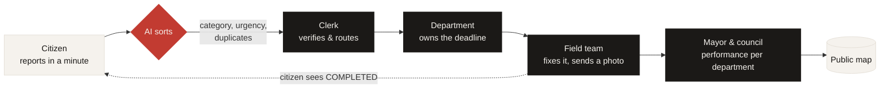

<div align="center">

<a href="https://sinjal-citizen.vercel.app">
  
</a>

<br>

<a href="https://sinjal-citizen.vercel.app/raporto"></a>
&nbsp;
<a href="https://sinjal-staff.vercel.app/login/"></a>

<br><br>

<a href="https://sinjal-citizen.vercel.app"></a>
<a href="https://sinjal-staff.vercel.app/login/"></a>


**[Report a problem](https://sinjal-citizen.vercel.app/raporto)** · **[Track a report](https://sinjal-citizen.vercel.app/gjurmo)** · **[Public map](https://sinjal-citizen.vercel.app/harta)** · **[Staff desktop](https://sinjal-staff.vercel.app/login/)**

</div>

---

## The problem: reports arrive everywhere, and land nowhere

In Elbasan, a broken street light can be reported by phone, SMS, email, chat, social media or a visit to the office. That's **5+ channels**, with **no central record** and **no follow-up loop**. Citizens face queues, physical visits and no anonymity, so many don't bother. Department heads have no reason to use software, and nothing shows which department delivered and which didn't.

> *"Their one-stop shop stalled: one department head delivered, another didn't, and nothing showed the difference."*
> — what Elbasan told us

## The solution: one channel

SINJAL gives every issue **one record, one owner and one deadline**, and lets the citizen watch it move:

<p align="center">
  
</p>

| | What it means |
|---|---|
| **One record** | A tracking code, a pin on the map, a clear follow-up. |
| **One owner** | The report is routed to the right department, which proves the fix with a photo. |
| **One deadline** | Set by priority, and measured as a strict performance indicator. |

### Try it in 60 seconds

1. **[Report a problem](https://sinjal-citizen.vercel.app/raporto)**: pick a category, drop a pin, add a photo. No account needed, and you can stay anonymous.
2. Keep the `SNJ-…` code and **[track it](https://sinjal-citizen.vercel.app/gjurmo)** at any time.
3. Once a team is working on it, it appears on the **[public map](https://sinjal-citizen.vercel.app/harta)**.

## From the street to the mayor's desk



Each department owns its deadlines, and leadership sees performance by department, category and zone, down to each single case.

## AI sorts. People decide.

<p align="center">
  
</p>

The AI does the sorting so staff can spend their time fixing problems. Responsibility stays with the municipality: below the confidence threshold a person decides, and every AI action is logged and can be undone.

| Capability | What it does | Status |
|---|---|---|
| **Category check** | Sorts "Other" reports and flags a wrong category | Live (AI worker) |
| **Routing** | Sends each report to the right department | Live (AI worker) |
| **Urgency detection** | Raises priority for safety risks, like an open manhole | Live (AI worker) |
| **Duplicate detection** | Merges reports of the same problem nearby into one case | Live (AI worker) |
| **Recurring cases** | Spots problems that come back after being fixed | Live (AI worker) |
| **Abuse moderation** | Flags spam and offensive text; obvious spam is rejected | Live (AI worker) |
| **Proof of fix** | Compares before and after photos, flags AI-made photos | In the Python backend, not yet connected to Supabase uploads |
| **Privacy moderation** | Blurs faces and plates, hides phone numbers | In the Python backend, not yet connected to Supabase uploads |

## Why SINJAL is different

There are many reporting channels across the Balkans. Some collect and forward reports, some cover a single utility, and some are run by an NGO or donor and stop when the project ends. None closes the loop. SINJAL does all five things that are missing:

- **One channel**, for every category
- **An owner, a deadline and proof of fix** for every report
- **Leadership sees each department's performance**
- **Anonymous reporting**, with a public record
- **Run by the municipality**, not a third party

## Built for everyone

- **Easy to use:** a simple interface for every level of digital literacy. *Even my grandma can use it.* True story: she did.
- **No extra work for staff:** it fits into the work they already do, with no extra people or resources.
- **Adoption, youth first:** students learn it in school, families see it at home, and phone and office reporting stay open for older residents, with staff logging those reports into SINJAL.

## Roadmap and costs

<table>
<tr>
<td width="33%" valign="top">

**Month 1: integratable**<br>
Open API and webhooks for municipal systems. Staff sign in with municipal accounts.

</td>
<td width="33%" valign="top">

**Month 2: every channel in**<br>
Phone and office reports logged into SINJAL. AI tuned on Elbasan's real reports.

</td>
<td width="33%" valign="top">

**Month 3: accountability live**<br>
A monthly performance report to the mayor. A public map with before and after photos.

</td>
</tr>
</table>

| Development (one-time) | Infrastructure (per municipality) | Maintenance (shared) |
|:---:|:---:|:---:|
| **~€48k**<br>4 people, 6 months | **~€1.5k / year**<br>no licence fees | **~20% / year**<br>one update for every municipality |

The workflow is built once and configured for anyone. Next sectors: private healthcare, education and airlines.

## What's in this repository

| Folder | What it is |
|---|---|
| [`sinjal-citizen-react/`](sinjal-citizen-react) | Citizen website: report, track, public map, bulletin (React, Vite, TypeScript) |
| [`sinjal-staff/`](sinjal-staff) | Staff desktop: reports, map, departments, automations, performance (React, Vite, TypeScript) |
| [`sinjal-login/`](sinjal-login) | Staff sign-in page, built into the staff desktop at `/login/` |
| [`supabase/`](supabase) | Database schema, row-level security, the functions both apps call, and the [setup guide](supabase/README.md) |
| [`app/`](app) | Python backend, including the AI worker (`python -m app.ai_loop`) |
| [`shared/`](shared) | Shared layout and translations |

**Stack:** React · Vite · TypeScript · Supabase (Postgres, Auth, Storage, Realtime) · Python (SQLAlchemy, OpenAI-compatible models) · Vercel · Render

<details>
<summary><b>Run it locally</b></summary>

<br>

Both apps run on Supabase. Create `.env.local` in `sinjal-citizen-react/` and in `sinjal-staff/`:

```env
VITE_SUPABASE_URL=https://<project-ref>.supabase.co
VITE_SUPABASE_ANON_KEY=<publishable key>
```

```bash
# Citizen website
cd sinjal-citizen-react && npm ci && npm run dev

# Staff desktop (then open /login/)
cd sinjal-staff && npm ci && npm run dev

# AI worker (AI_MOCK=1 runs without an AI key)
pip install -r requirements-ai.txt
DATABASE_URL="postgresql://…" AI_MOCK=1 python -m app.ai_loop
```

Setting up a new Supabase project (schema, staff accounts and deployment) is covered step by step in [`supabase/README.md`](supabase/README.md).

</details>

<details>
<summary><b>Deploy it</b></summary>

<br>

| Part | Where | Settings |
|---|---|---|
| Citizen website | Vercel | Root directory `sinjal-citizen-react`, plus the two `VITE_SUPABASE_*` variables |
| Staff desktop | Vercel | Root directory `sinjal-staff`, plus the two `VITE_SUPABASE_*` variables |
| AI worker | Render background worker | `pip install -r requirements-ai.txt`, then `python -m app.ai_loop`, with `DATABASE_URL` and the `AI_*` variables |

The publishable key is safe in the browser: row-level security protects the data. The database connection string and the AI key stay on the worker only.

</details>

## Team Nexora

| | | | |
|:---:|:---:|:---:|:---:|
| **Arjola Metaliaj**<br>Team Lead, Product Designer | **Asja Xhelezi**<br>Frontend Lead | **Ederta Kariqi**<br>AI Integration Lead | **Albjan Mehmetaj**<br>Backend & Security Lead |

Built at the **AI4Society Hackathon**, with the support of **Build Green Group**, **EIT Community Albania** and **Open Society Foundations Western Balkans**.

<div align="center">

<br>

**[Try it yourself: sinjal-citizen.vercel.app](https://sinjal-citizen.vercel.app)**

<sub>© 2026 SINJAL · Team Nexora</sub>

</div>
